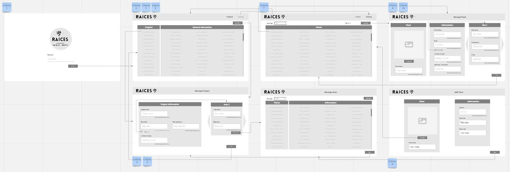
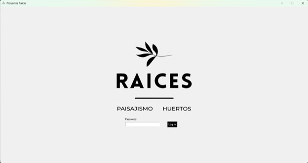
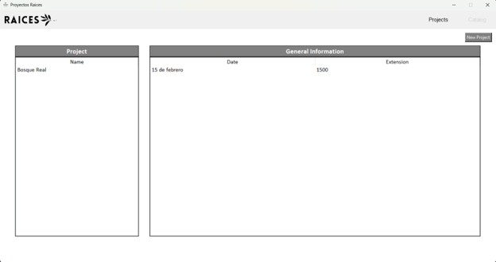
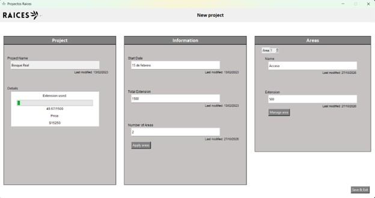
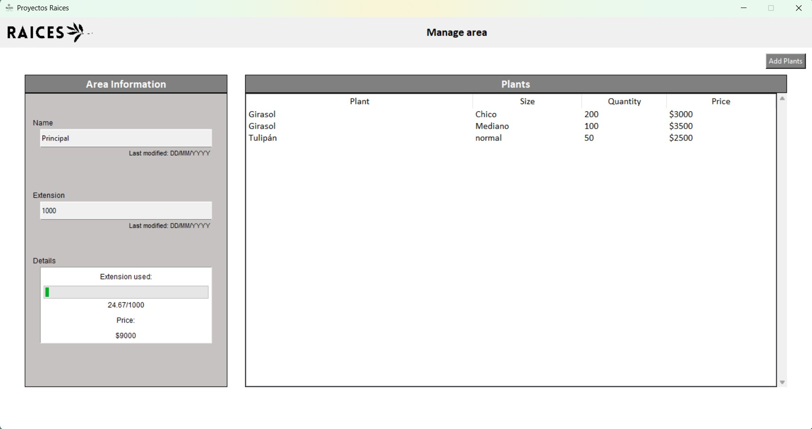
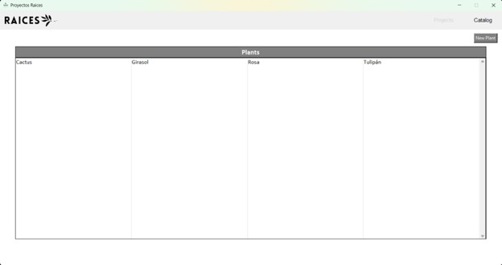
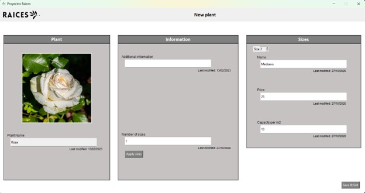

# Landscaping Project Planner

## Overview

As part of the International Baccalaureate (IB) Diploma Programme, I developed a final project for the Informatics subject in collaboration with a real client. My client was my mother, who works in landscaping and manages multiple projects simultaneously.

Each project consists of several designated areas, such as an entrance, terrace, or garden, which are filled with different plants. To simplify this process, I developed a program that allows users to store plant information locally on a computer, including plant sizes, prices, and additional notes.

Users can create individual landscaping projects and divide them into designated areas. Plants can then be assigned to each area, allowing users to plan the layout and automatically calculate the total occupied area and the associated costs.

## Key Features

- **Plant Database:** Store plant information locally, including sizes, prices, and additional notes.
- **Project Management:** Create and manage individual landscaping projects.
- **Area Organization:** Divide projects into designated areas, such as entrances, terraces, and gardens.
- **Plant Assignment:** Add plants to specific areas to plan the landscaping layout.
- **Area Calculation:** Calculate the total area occupied by the selected plants.
- **Cost Calculation:** Calculate the associated costs of the selected plants.

## Technical Implementation

**Programming Language:** Python and SQL

**Libraries / Frameworks:** tkinter

**Data Storage:** MySQL local database

**Main Programming Concepts:** Object-oriented programming, Data structures, User interface design, Data validation and Error Handling.

### How It Works

1. Users add plants to the local database, including their dimensions, prices, and notes.
2. Users create a landscaping project and divide it into designated areas.
3. Plants are assigned to the relevant areas.
4. The application calculates the total area occupied by the plants and the associated costs.

**Security and User Management:** Security was also considered during development. A user account system was implemented to accommodate potential company growth and allow multiple users to access the application. This system also provides a foundation for introducing role-based access control in the future, allowing different permission levels to restrict which features users can access or modify.

## Challenges and Problem-Solving

To minimize rework during development, I created a graphical prototype of the application in collaboration with the client before starting the programming process. The prototype was presented to the client, and the necessary adjustments were made to agree on the layout and navigation of each window in advance. This provided a clear visual reference during development and simplified the implementation of the individual screens.

However, despite this initial planning, usability remained a challenge. The client did not always navigate the finished application as expected, revealing differences between the intended workflow and the actual user experience. Consequently, several changes had to be implemented after the initial version was completed. This highlighted the importance of not only agreeing on the design beforehand, but also testing the application with the intended user and refining it based on their feedback.

## Screenshots

*Initial sketch*

*Homepage*

*Projects page*

*Manage project page*

*Manage area page*

*Plant catalog page*

*Plant page*

## Video

*Click the image to watch the project demonstration on YouTube.*

## Outcome and Learning

The project provided practical experience in developing software for a real client's needs. It involved translating a real-world workflow into a functional application.

[Add what you learned, what worked well, and any improvements you would make.]

## Project Context

- **Programme:** International Baccalaureate Diploma Programme
- **Subject:** Informatics
- **Project Type:** Individual academic project for a real client
- **Client:** Landscaping professional
- **Year:** 2022-2023
