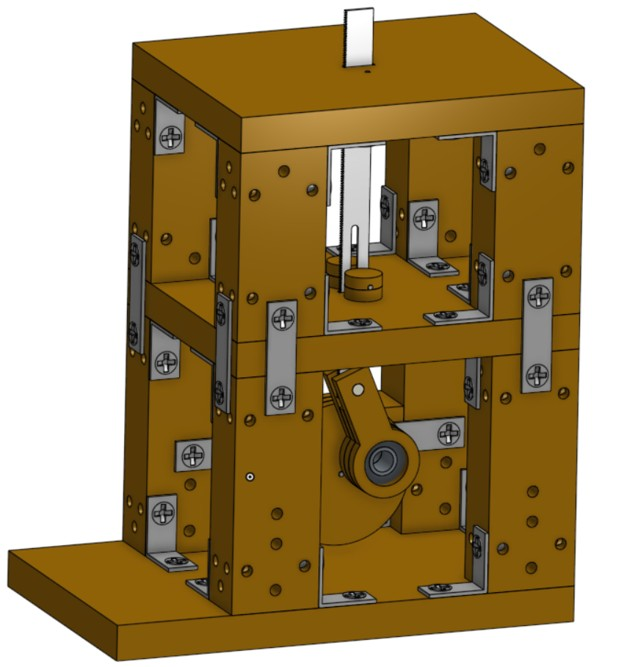
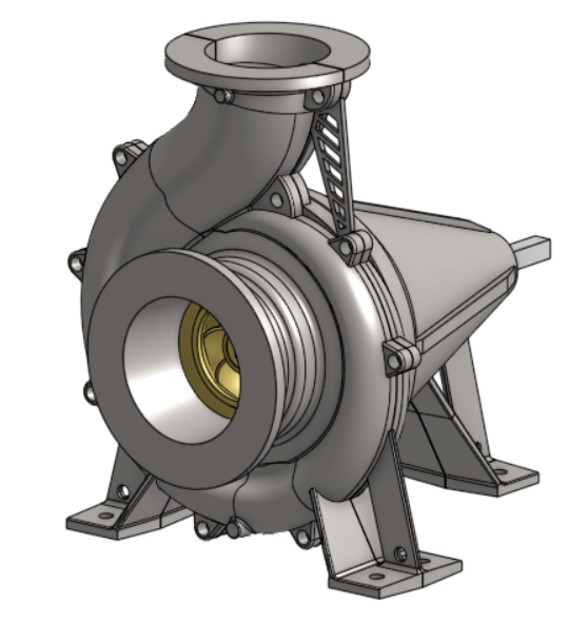
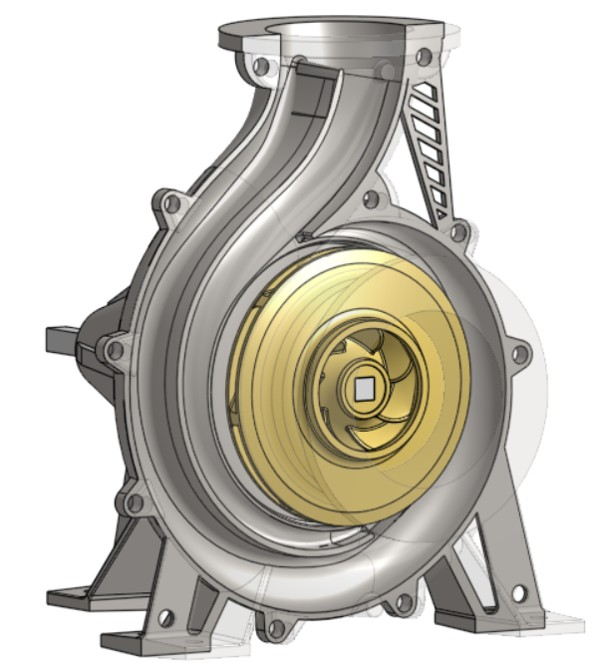

# Projects at Tecnológico de Monterrey, Mexico

## Overview

A collection of four mechanical design and manufacturing projects completed during my first year of university studies in Mexico. Each project was developed over a six-week period, covering the entire design process, from initial concept development and 3D modeling to prototyping and the manufacturing of a finished physical product.

### 1. Slider-crank mechanism

**Software:** OnShape

**Objective:** To be able to cut paper using a small 5V DC-Motor. 

**Design Process:** As a team, we opted for a simple tablelike design. The biggest issue was the slider since we had to use the blade from a bow saw, so having teeth everywhere was a problem. We eventually solved it by adding a bar and a hole inside the saw that would ensure the blade stayed vertical.

**Manufacturing:** The whole thing was manufactured using existing pieces and wood. We used a laser cutter for the small parts, and the big parts were cut manually.

---

### 2. Water pump

**Software:** OnShape

**Objective:** Develop a pump that creates a circulatory flow and add a flow sensor to test for leaks inside the system.

**Design Process:** Since my knowledge in water pumps was zero, the main body was taken from an online experienced creator, and then further modifications and the completion of the whole body was done by me. 

**Manufacturing:** This item was printed in 3D and other parts like the shaft were bought and implemented to the system according to their measurements.

---

---
