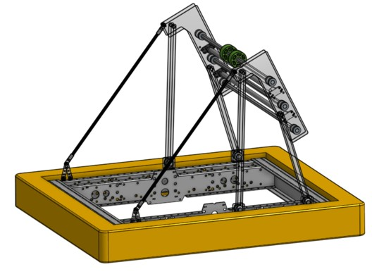
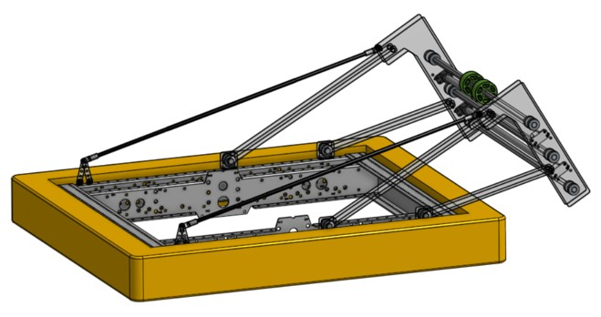
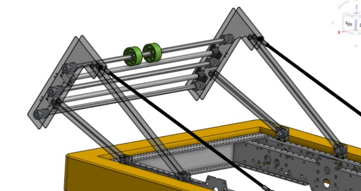
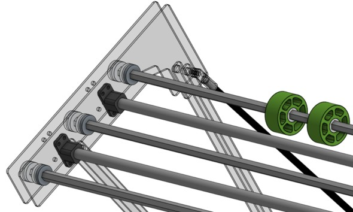
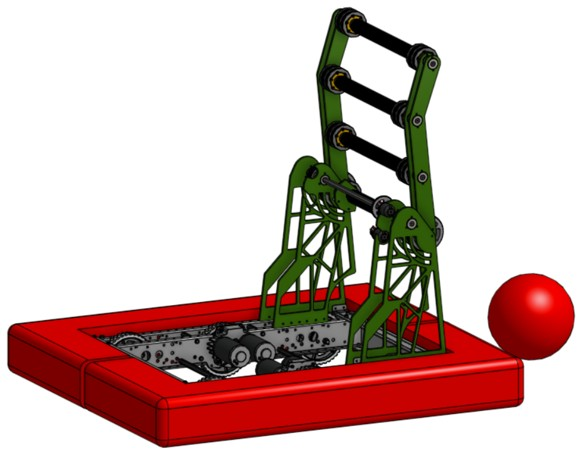
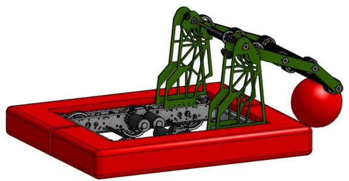
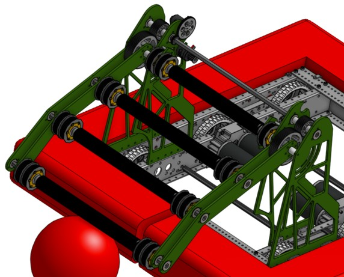
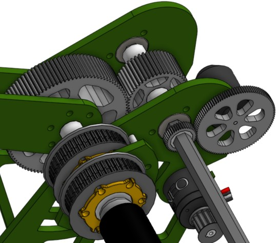

# Buluk #3472 Intakes for 2022 Competition

## Overview

As part of the 2022 FIRST Robotics Competition, I was responsible for designing and prototyping two different intake mechanisms using CAD. I then manufactured physical prototypes to evaluate and compare their functionality, helping determine which design was best suited for the robot.

**Software:** OnShape

**Objective:** Develop several prototypes using CAD software, prototype them and manufacture the final one for the competition. 

**Design Process:** A meeting of the design branch of the mechanical section of the team was done in which a brainstorm of ideas was done to come up with several designs for an intake for our robot, a way to get the match balls inside the chassis. After, the different ideas were spread equally in teams of two, my team ended with two designs which are presented below.

**Manufacturing:** The core structure of both intakes was completely done of MDF as a prototype, adapting all the measurements to current existing pieces that are intended to use. None of these two designs were used in the final robot going to the competition

### 1. First Prototype

### 2. Second Prototype

