# Projects at Tecnológico de Monterrey, Mexico

## Overview

A collection of four mechanical design and manufacturing projects completed during my first year of university studies in Mexico. Each project was developed over a six-week period, covering the entire design process, from initial concept development and 3D modeling to prototyping and the manufacturing of a finished physical product.

### 1. Slider-crank mechanism

**Software:** OnShape

**Objective:** To be able to cut paper using a small 5V DC-Motor. 

**Design Process:** As a team, we opted for a simple tablelike design. The biggest issue was the slider since we had to use the blade from a bow saw, so having teeth everywhere was a problem. We eventually solved it by adding a bar and a hole inside the saw that would ensure the blade stayed vertical.

**Manufacturing:** The whole thing was manufactured using existing pieces and wood. We used a laser cutter for the small parts, and the big parts were cut manually.

*CAD Model*

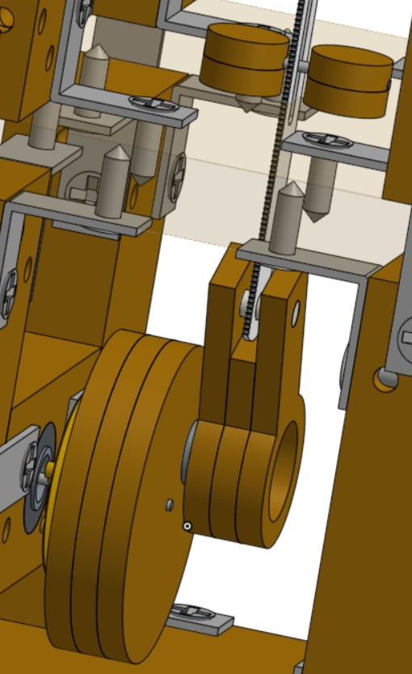

*Close-up view*

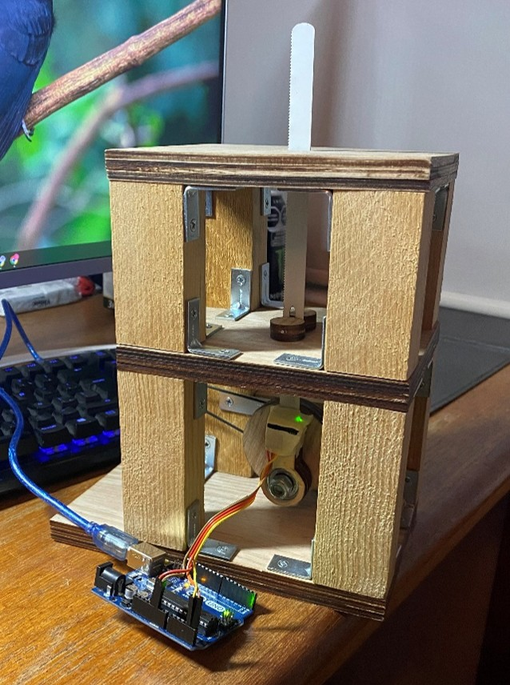

*Finished product*

---

### 2. Water pump

**Software:** OnShape

**Objective:** Develop a pump that creates a circulatory flow and add a flow sensor to test for leaks inside the system.

**Design Process:** Since my knowledge in water pumps was zero, the main body was taken from an online experienced creator, and then further modifications and the completion of the whole body was done by me. 

**Manufacturing:** This item was printed in 3D and other parts like the shaft were bought and implemented to the system according to their measurements.

*CAD Model*

*Close-up view*

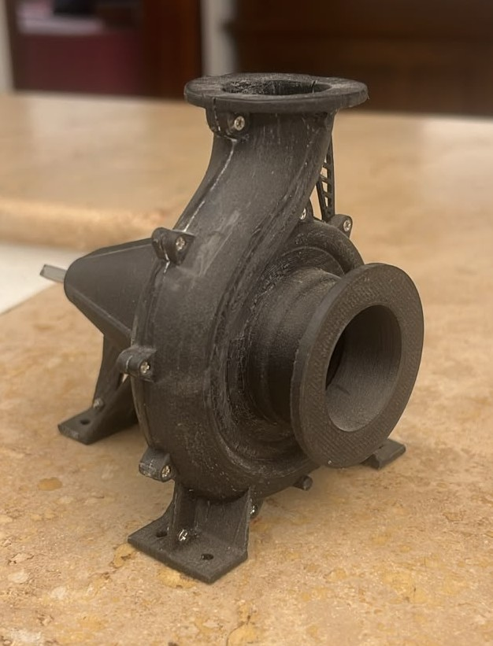

*Final Product*

---

### 3. Solar heater

**Software:** OnShape

**Objective:** Develop a parabolic solar heater completely out of carton and aluminum foil that will make water inside a can boil.

**Design Process:** For our design the biggest problem was that it had to be made up entirely out of carton. We first started with a solid structure capable of being handled a lot and titling 360 degrees, so the sun always hits it directly, and all the heat is completely concentrated in the focus of the parabola. 

**Manufacturing:** After designing it, it was cut using a laser cutter.

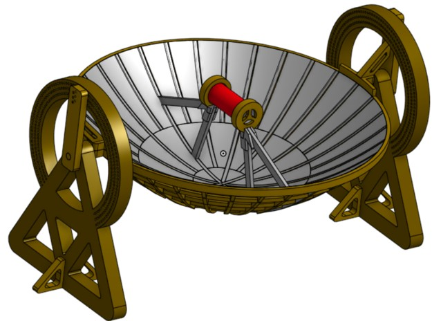

*CAD Model*

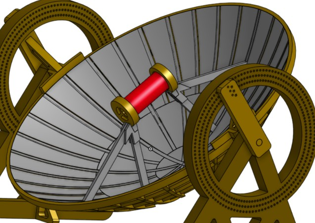

*Close-up view*

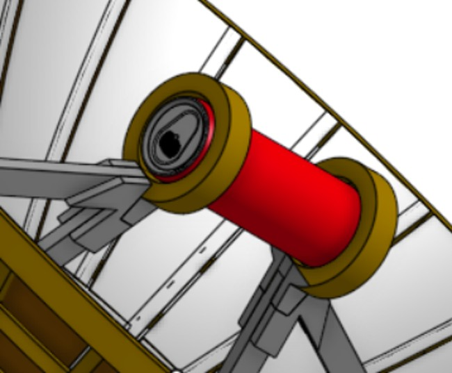

*Additional design detail*

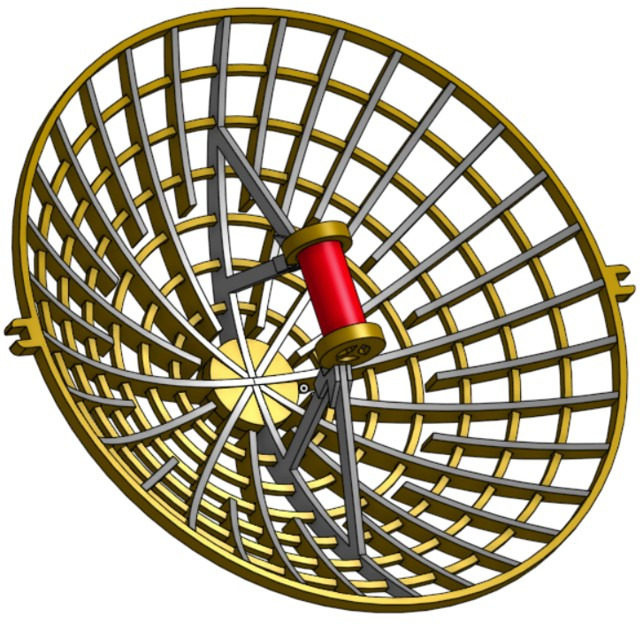

*Support*

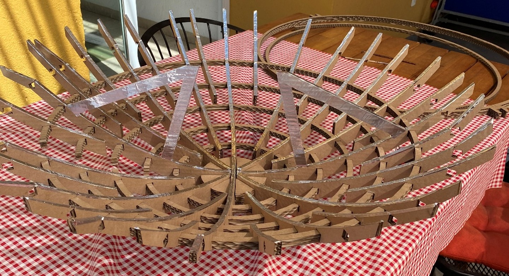

*Physical support*

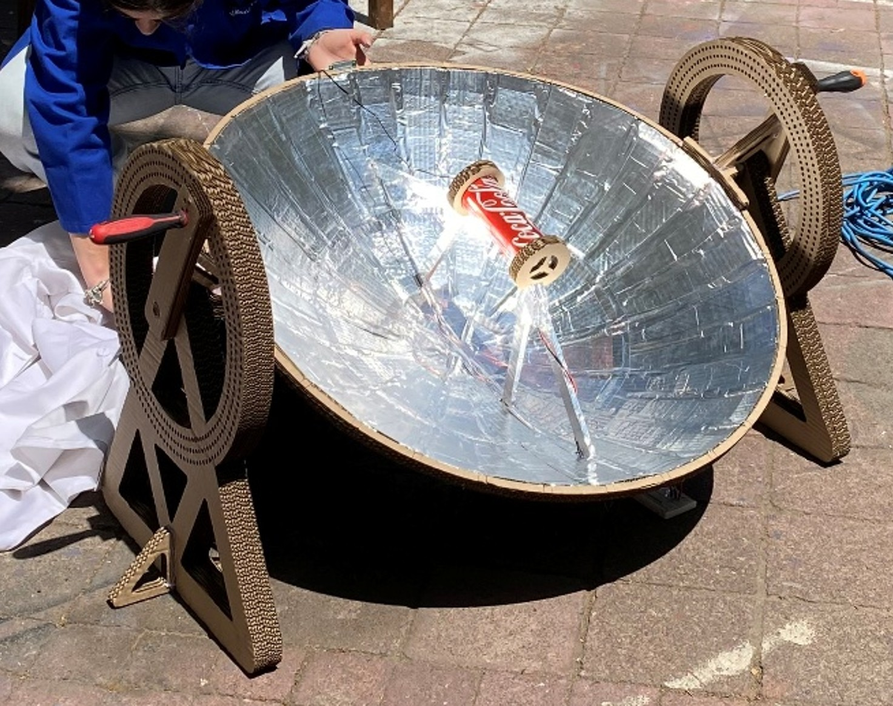

*Finished product*

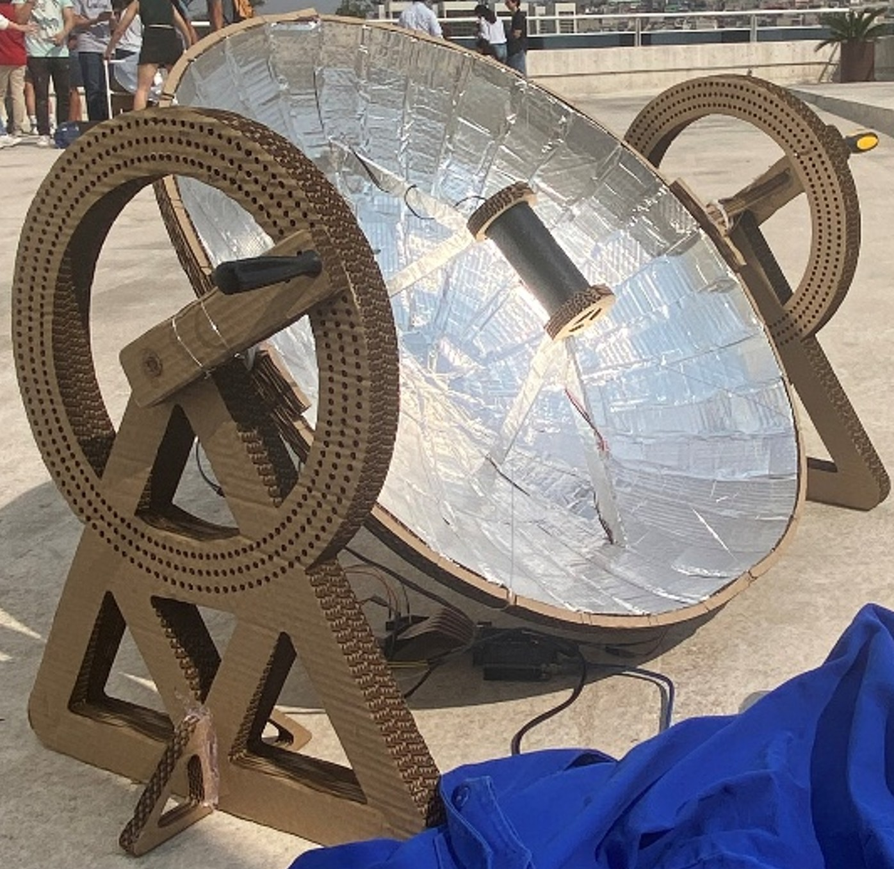

*Finish product being utilized*

---

### 4. Transformer

**Software:** SolidWorks

**Objective:** Study the influence of the distance between the primary and secondary windings in the final yielded current.

**Design Process:** Our design consisted of a tower with two interconnected infinite screws to ensure that the distance can be progressively increased. 

**Manufacturing:** It was made from wood and existing parts. The wood parts were manufactured using Router CNC.

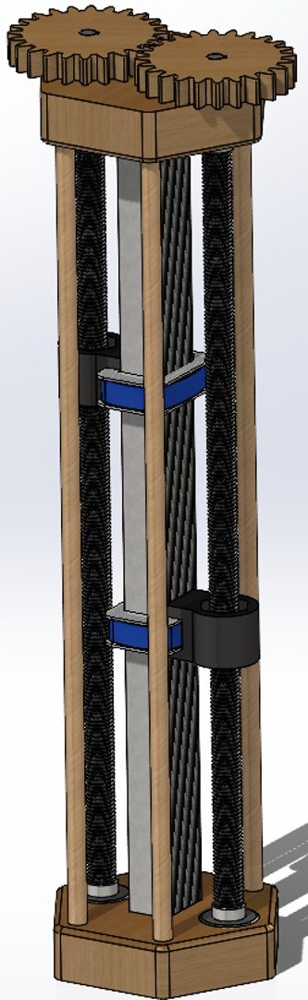

*CAD Model*

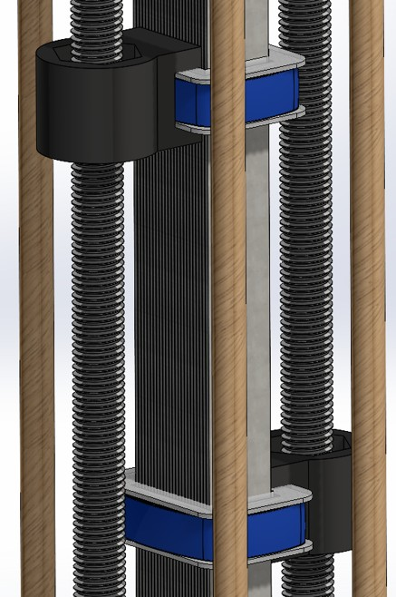

*Close-up view*

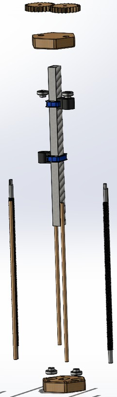

*Exploded view*

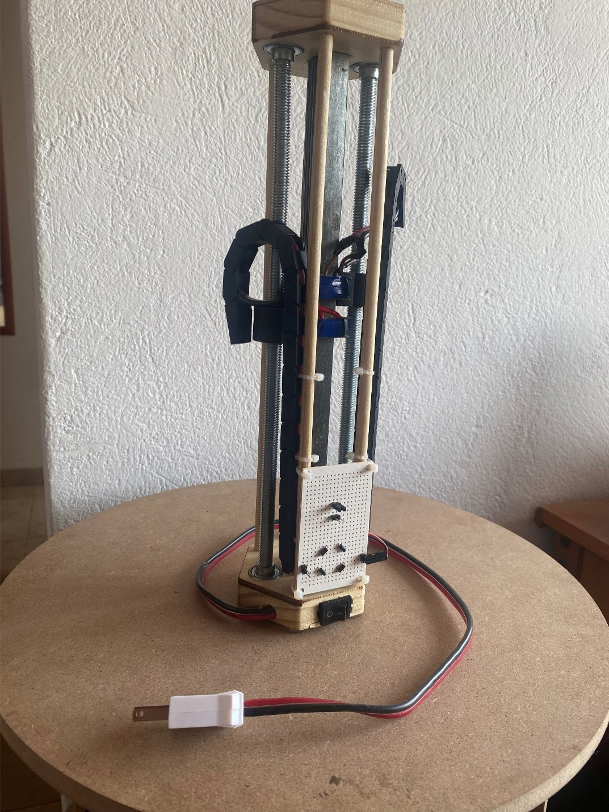

*Finished product*
